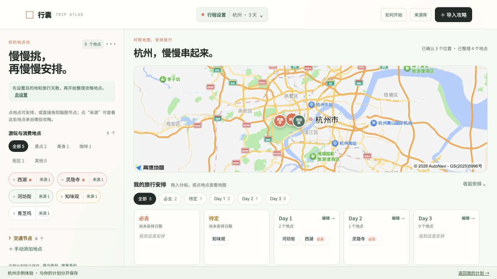

# 行囊 · Trip Atlas

把收藏里的旅行地点，串成自己的旅行。

行囊面向习惯收藏攻略的自由行用户，将分散地点整理为可追溯的地点池，再通过地图、优先级和按天安排帮助用户做自己的选择。项目由真实旅行整理需求出发，经历 PRD、MVP 取舍、原型实现与交互迭代。



## 30 秒体验

启动后打开首页，点击“如何开始”→“体验杭州示例”。示例和个人计划使用独立存储，不会覆盖个人行程。示例提供 3 个选定地图位置、2 天安排和手动交通段。

当前公开部署链接和 GitHub 远程发布仍需完成账号连接；本地演示：`http://127.0.0.1:5173/?demo=1`。只有发布成功后才会在此处添加公开地址。

## 核心流程

攻略文字 → 可编辑 POI 候选 → 分类、清洗与去重 → 地点池 → 地图确认 → 必去/待定与 Day 安排 → 单日排序、备注和交通段。

- **多来源整理：** 保存分享链接和来源标题；正文文字导入后提取候选，重复地点合并保留来源。
- **规则与可选 AI：** 默认规则提取；配置模型服务后可用 AI 结构化提取，候选附原文证据。证据不在原文中的结果会被过滤，用户仍需确认。
- **地图工作台：** 高德底图、人工确认位置、地图和安排联动。首次点标记聚焦，第二次点同一标记打开详情。
- **单日编辑：** 拖拽地点排序、时段和地点备注；相邻地点可选交通方式、手填预计分钟数、关联交通节点。
- **补充与保存：** 手动添加地点、按需查询城市、浏览器本地保存、JSON 导出与恢复。
- **受控降级：** 缺地图配置、搜索失败或未启用 AI 时，保留本地整理能力并明确提示。

## 当前边界

- 小红书链接用于来源留存与回看，**未接入自动读取笔记正文**；不会访问账号收藏夹。
- 当前尚无模型 API Key，AI 接口已实现并通过模拟服务测试，**默认实际运行的是规则识别**。真实模型效果和延迟尚未测量。
- 一份计划只支持一个中国大陆城市、2–5 天。常用城市可离线选择，其他城市需要在线查询；未配置高德搜索时不能确认额外城市。
- 交通方式与时长由用户填写，未进行真实道路规划、实时交通或行程预警。
- 数据保存在当前浏览器，不提供账号、云同步或多人协作；请使用导出备份。
- 这是独立产品原型，尚未取得真实用户量或转化率数据。

## 本地运行

需要 Node.js 24+，使用 pnpm 10。

```bash
pnpm install
cp .env.example .env.local
# 按需填写 .env.local，勿提交该文件
pnpm dev
```

不配置任何 Key 也可使用地点整理功能。地图底图和在线位置查询需要分别配置。

| 环境变量 | 用途 | 所在位置 |
| --- | --- | --- |
| VITE_AMAP_JS_KEY | 高德 Web 端 JS API Key | 浏览器配置，设置域名限制 |
| VITE_AMAP_SECURITY_JS_CODE | 高德 JS API 安全配置 | 当前浏览器加载方案的配置 |
| AMAP_WEB_SERVICE_KEY | 地点及城市搜索 | 仅服务端 |
| AI_API_KEY | 可选模型 API Key | 仅服务端 |
| AI_BASE_URL | OpenAI 兼容 API 基础地址，包含 /v1 等路径 | 仅服务端 |
| AI_MODEL | 模型名称 | 仅服务端 |

`VITE_` 变量会进入浏览器构建；不要用此命名存放 Web 服务或模型 Key。`AI_BASE_URL` 和 `AI_MODEL` 必须匹配所用服务商。接口要求支持 Chat Completions 和 JSON object 输出。

## 测试与构建

```bash
pnpm test
pnpm build
```

Node 内置测试覆盖输入校验、上游异常、AI 原文证据、重复地点、独立优先级与日期、来源删除、交通段清理。GitHub Actions 在 push 和 pull request 时运行测试与构建。

`pnpm preview` 只预览静态构建，不提供服务端 API。需要完整闭环时用 `pnpm dev` 或线上 Serverless 部署。

## 部署

项目提供 Vercel 配置和四个 Serverless 入口：

- `/api/config`：返回能力开关，不返回密钥。
- `/api/poi-search`：按地点名和当前城市查询少量候选。
- `/api/city-search`：确认非预置城市的行政编码。
- `/api/extract-pois`：可选的 AI 地点提取。

线上与本地使用相同的 `server/api.mjs` 实现。配置环境变量并重新部署后，将线上域名加入高德安全设置。完整操作见 [部署指南](docs/DEPLOYMENT.md)。GitHub Pages 单独托管静态文件不能提供这些接口。

## 技术与目录

React 19、TypeScript、Vite、dnd-kit、高德 JS API 2.0、localStorage、Web Request/Response 服务端接口。

```text
src/features/plan/      计划状态、本地恢复和数据模型
src/features/import/    规则识别与可选 AI 客户端
src/features/map/       地图加载、标记、地点搜索
src/features/ReleaseUi.tsx  引导、手动添加和备份
src/App.tsx            地图与行程工作台、导入及详情
server/                共享接口逻辑与 Node 适配器
api/                   Vercel Serverless 入口
tests/                 产品状态与接口回归测试
memory-bank/           PRD 演进、架构、实施计划和进度
docs/                  截图、部署说明、项目案例
```

`app.js` 是保留的早期原型，不被当前入口加载；`style.css` 仍作为共享基础样式加载，新增页面样式位于 `src/`。

## 产品判断

用户的难点是把已有收藏变成自己的选择。首版优先验证地点整理与空间化安排：人决定去哪、哪天去，工具负责收拢信息与保持状态一致。AI 在可配置增强层中负责理解非结构化文字，地图匹配和用户确认负责位置与取舍。

更多产品过程见 [项目案例](docs/CASE_STUDY.md)。
